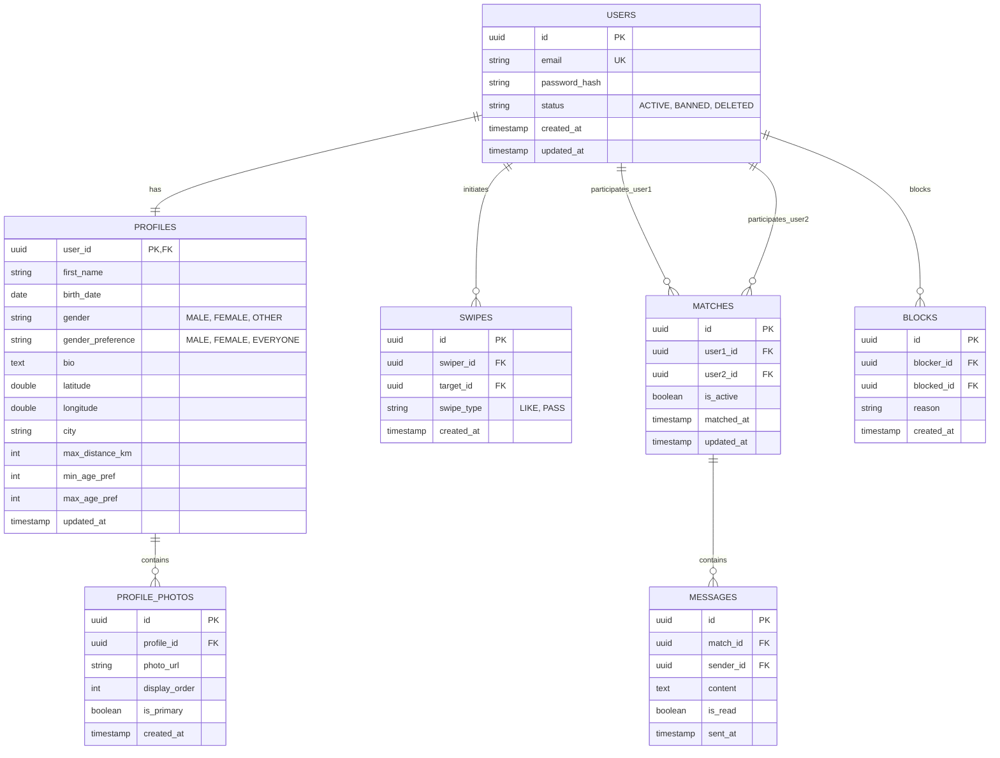
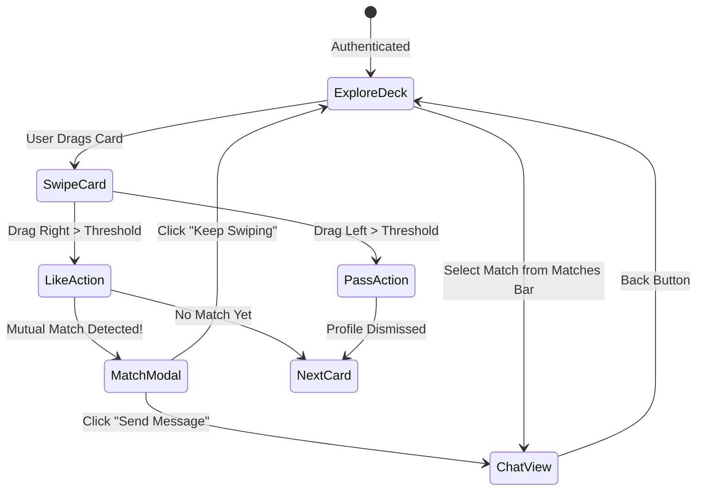
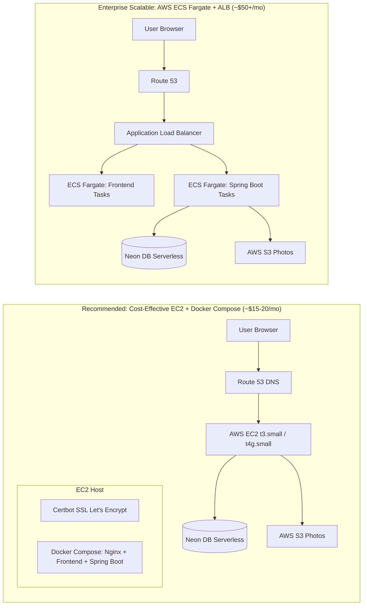

# Dating App MVP — Master Product Requirement Document (PRD) & Technical Architecture Plan

---

## 1. Executive Summary & MVP Scope

### 1.1 Product Vision
To build a lightweight, responsive, and reliable Minimum Viable Product (MVP) of a dating application. The app allows users to create a personal profile, discover potential matches based on location/age/gender preferences, swipe right/left, form mutual matches, and chat in real-time.

### 1.2 Target Audience & Core Assumptions
* **Target Audience:** Young adults (18–35) seeking local connections and dates.
* **Core Hypothesis:** A clean swipe interface, instant mutual match notification, and responsive real-time chat are sufficient to validate core user engagement.
* **MVP Boundary:** Focus strictly on the "Core Match Loop": **Register $\to$ Setup Profile $\to$ Discover & Swipe $\to$ Match $\to$ Real-time Chat**.

### 1.3 Feature Matrix (In-Scope vs. Out-of-Scope)

| Feature Category | In MVP Scope (Phase 1) | Post-MVP / Out of Scope (Phase 2+) |
| :--- | :--- | :--- |
| **Authentication** | Email/Password with JWT, BCrypt, session refresh | OAuth (Google/Apple), Phone OTP (Twilio) |
| **Profile** | Name, Bio, Gender, Birthdate (Age calculation), Location (City/GPS), 1–6 Photos | Video prompts, Instagram/Spotify integration, personality quizzes |
| **Discovery / Feed** | Deck of profiles filtered by gender preference, age range, max distance | AI/ML-driven collaborative filtering, "Rewind" last swipe |
| **Swiping & Matching** | Swipe Right (Like), Swipe Left (Pass), Instant Match detection | "Super Likes", "Boosts", Read Receipts |
| **Chat / Messaging** | 1-on-1 Real-time text messaging over WebSockets (STOMP), message history | Voice/video calls (WebRTC), photo/voice note sharing in chat |
| **Safety & Moderation** | Unmatch user, Block user, basic Report flagging | Automated photo NSFW verification (AWS Rekognition) |
| **Monetization** | None (100% Free for MVP validation) | Stripe/In-App Subscriptions (Tinder Gold/Plus model) |

---

## 2. System Architecture Overview

```mermaid
flowchart TD
    subgraph Client ["Frontend (React SPA)"]
        UI["React 18 + Vite + Tailwind"]
        State["TanStack Query + Zustand"]
        WSClient["SockJS + STOMP Client"]
    end

    subgraph AWS ["AWS Cloud Infrastructure (EC2 / ECS)"]
        subgraph DockerHost ["Docker Engine / Docker Compose"]
            Nginx["Nginx Reverse Proxy / SSL (Port 80/443)"]
            FrontContainer["React Static Container (Alpine Nginx)"]
            BackContainer["Spring Boot 3 REST & STOMP (Port 8080)"]
        end
        S3["AWS S3 Bucket (Profile Photos)"]
    end

    subgraph Database ["Neon DB (Serverless PostgreSQL)"]
        NeonPool["Neon Connection Pool (PgBouncer)"]
        PostgresDB[("PostgreSQL 16 + PostGIS / Lat-Lon Indices")]
    end

    UI --> Nginx
    WSClient --> Nginx
    Nginx -->|/ (Static Files)| FrontContainer
    Nginx -->|/api/* & /ws/*| BackContainer
    BackContainer -->|JDBC (SSL)| NeonPool
    NeonPool --> PostgresDB
    BackContainer -->|Pre-signed URLs / Uploads| S3
```

---

## 3. Database & Backend PRD (NeonDB + Spring Boot 3)

### 3.1 Database Specification (Neon DB - PostgreSQL 16)
Neon DB provides serverless PostgreSQL with connection pooling. The backend will connect via Neon's pooled endpoint (`-pooler` connection string) over TLS/SSL (`sslmode=require`).

#### 3.1.1 Entity Relationship Diagram (ERD)



#### 3.1.2 Database Schema DDL (PostgreSQL Syntax)

```sql
-- Enable UUID extension
CREATE EXTENSION IF NOT EXISTS "uuid-ossp";

-- 1. Users Table
CREATE TABLE users (
    id UUID PRIMARY KEY DEFAULT uuid_generate_v4(),
    email VARCHAR(255) NOT NULL UNIQUE,
    password_hash VARCHAR(255) NOT NULL,
    status VARCHAR(20) NOT NULL DEFAULT 'ACTIVE',
    created_at TIMESTAMP WITH TIME ZONE DEFAULT CURRENT_TIMESTAMP,
    updated_at TIMESTAMP WITH TIME ZONE DEFAULT CURRENT_TIMESTAMP
);

-- 2. Profiles Table
CREATE TABLE profiles (
    user_id UUID PRIMARY KEY REFERENCES users(id) ON DELETE CASCADE,
    first_name VARCHAR(50) NOT NULL,
    birth_date DATE NOT NULL,
    gender VARCHAR(20) NOT NULL,
    gender_preference VARCHAR(20) NOT NULL DEFAULT 'EVERYONE',
    bio TEXT,
    latitude DOUBLE PRECISION,
    longitude DOUBLE PRECISION,
    city VARCHAR(100),
    max_distance_km INT NOT NULL DEFAULT 50,
    min_age_pref INT NOT NULL DEFAULT 18,
    max_age_pref INT NOT NULL DEFAULT 50,
    updated_at TIMESTAMP WITH TIME ZONE DEFAULT CURRENT_TIMESTAMP
);

-- 3. Profile Photos
CREATE TABLE profile_photos (
    id UUID PRIMARY KEY DEFAULT uuid_generate_v4(),
    profile_id UUID NOT NULL REFERENCES profiles(user_id) ON DELETE CASCADE,
    photo_url TEXT NOT NULL,
    display_order INT NOT NULL DEFAULT 0,
    is_primary BOOLEAN NOT NULL DEFAULT FALSE,
    created_at TIMESTAMP WITH TIME ZONE DEFAULT CURRENT_TIMESTAMP
);

-- 4. Swipes (Likes & Passes)
CREATE TABLE swipes (
    id UUID PRIMARY KEY DEFAULT uuid_generate_v4(),
    swiper_id UUID NOT NULL REFERENCES users(id) ON DELETE CASCADE,
    target_id UUID NOT NULL REFERENCES users(id) ON DELETE CASCADE,
    swipe_type VARCHAR(10) NOT NULL CHECK (swipe_type IN ('LIKE', 'PASS')),
    created_at TIMESTAMP WITH TIME ZONE DEFAULT CURRENT_TIMESTAMP,
    CONSTRAINT uq_swiper_target UNIQUE (swiper_id, target_id)
);

-- 5. Matches Table (Always store user1_id < user2_id to prevent duplicates)
CREATE TABLE matches (
    id UUID PRIMARY KEY DEFAULT uuid_generate_v4(),
    user1_id UUID NOT NULL REFERENCES users(id) ON DELETE CASCADE,
    user2_id UUID NOT NULL REFERENCES users(id) ON DELETE CASCADE,
    is_active BOOLEAN NOT NULL DEFAULT TRUE,
    matched_at TIMESTAMP WITH TIME ZONE DEFAULT CURRENT_TIMESTAMP,
    updated_at TIMESTAMP WITH TIME ZONE DEFAULT CURRENT_TIMESTAMP,
    CONSTRAINT uq_matched_pair UNIQUE (user1_id, user2_id),
    CONSTRAINT chk_user_order CHECK (user1_id < user2_id)
);

-- 6. Messages Table
CREATE TABLE messages (
    id UUID PRIMARY KEY DEFAULT uuid_generate_v4(),
    match_id UUID NOT NULL REFERENCES matches(id) ON DELETE CASCADE,
    sender_id UUID NOT NULL REFERENCES users(id) ON DELETE CASCADE,
    content TEXT NOT NULL,
    is_read BOOLEAN NOT NULL DEFAULT FALSE,
    sent_at TIMESTAMP WITH TIME ZONE DEFAULT CURRENT_TIMESTAMP
);

-- 7. Blocks Table
CREATE TABLE blocks (
    id UUID PRIMARY KEY DEFAULT uuid_generate_v4(),
    blocker_id UUID NOT NULL REFERENCES users(id) ON DELETE CASCADE,
    blocked_id UUID NOT NULL REFERENCES users(id) ON DELETE CASCADE,
    reason TEXT,
    created_at TIMESTAMP WITH TIME ZONE DEFAULT CURRENT_TIMESTAMP,
    CONSTRAINT uq_blocker_blocked UNIQUE (blocker_id, blocked_id)
);

-- Indices for Fast Performance
CREATE INDEX idx_swipes_swiper ON swipes(swiper_id);
CREATE INDEX idx_swipes_target ON swipes(target_id);
CREATE INDEX idx_matches_users ON matches(user1_id, user2_id);
CREATE INDEX idx_messages_match ON messages(match_id, sent_at DESC);
CREATE INDEX idx_profiles_geo ON profiles(latitude, longitude);
```

#### 3.1.3 Discovery Geospatial & Exclusion Query
The core query selects candidates:
1. Within user's age preferences (`min_age_pref` to `max_age_pref`).
2. Matching gender preferences.
3. Within distance radius (Haversine distance in KM):
   $$\text{distance} = 6371 \times \arccos(\cos(\text{rad}(lat_1))\cos(\text{rad}(lat_2))\cos(\text{rad}(lon_2)-\text{rad}(lon_1)) + \sin(\text{rad}(lat_1))\sin(\text{rad}(lat_2)))$$
4. **Not** already swiped by the current user.
5. **Not** blocked by either party.

---

### 3.2 Backend Specification (Spring Boot 3 + Java 21)

#### 3.2.1 Technology Stack & Libraries
* **Framework:** Spring Boot 3.3.x (Java 21 LTS)
* **Security:** Spring Security + `jjwt` (HMAC-SHA256 stateless JWT) + BCrypt Password Encoder
* **Persistence:** Spring Data JPA + Hibernate 6 + Neon PostgreSQL Driver
* **Migrations:** Flyway (`src/main/resources/db/migration/V1__init.sql`)
* **Real-time:** Spring WebSocket (`org.springframework.boot:spring-boot-starter-websocket`) with STOMP over SockJS
* **Cloud Storage:** AWS SDK for Java v2 (`software.amazon.awssdk:s3`) for S3 pre-signed upload URLs
* **Validation & Utilities:** `spring-boot-starter-validation`, Lombok, MapStruct

#### 3.2.2 Spring Boot Package Structure
```text
src/main/java/com/datingapp/
├── config/              # SecurityConfig, WebSocketConfig, S3Config, CorsConfig
├── controller/          # AuthController, ProfileController, DiscoveryController, SwipeController, MatchController, ChatController
├── dto/
│   ├── request/         # LoginRequest, RegisterRequest, ProfileUpdateRequest, SwipeRequest, MessageRequest
│   └── response/        # AuthResponse, ProfileResponse, DiscoveryCardDto, MatchResponse, MessageDto
├── entity/              # User, Profile, ProfilePhoto, Swipe, Match, Message, Block
├── exception/           # GlobalExceptionHandler, Custom Exceptions
├── repository/         # UserRepository, ProfileRepository, SwipeRepository, MatchRepository, MessageRepository
├── security/            # JwtAuthenticationFilter, JwtTokenProvider, UserDetailsServiceImpl
└── service/             # AuthService, ProfileService, DiscoveryService, SwipeService, MatchService, ChatService, S3StorageService
```

#### 3.2.3 RESTful API Endpoints Matrix

| Module | Method | Endpoint | Description | Auth Required |
| :--- | :--- | :--- | :--- | :--- |
| **Auth** | `POST` | `/api/v1/auth/register` | Register new user with email & password | No |
| **Auth** | `POST` | `/api/v1/auth/login` | Authenticate and return JWT token | No |
| **Auth** | `GET` | `/api/v1/auth/me` | Fetch current authenticated user info | Yes |
| **Profile**| `GET` | `/api/v1/profiles/me` | Get own profile with photos | Yes |
| **Profile**| `PUT` | `/api/v1/profiles/me` | Update bio, location, preferences | Yes |
| **Profile**| `POST` | `/api/v1/profiles/photos/presign` | Get S3 pre-signed URL to upload photo | Yes |
| **Profile**| `POST` | `/api/v1/profiles/photos` | Save uploaded photo URL into profile | Yes |
| **Profile**| `DELETE`| `/api/v1/profiles/photos/{id}`| Remove photo | Yes |
| **Discovery**| `GET` | `/api/v1/discovery/feed?limit=20`| Fetch deck of profiles to swipe on | Yes |
| **Swipe** | `POST` | `/api/v1/swipes` | Submit a swipe (`LIKE` or `PASS`) | Yes |
| **Match** | `GET` | `/api/v1/matches` | Get list of user's active matches | Yes |
| **Match** | `DELETE`| `/api/v1/matches/{id}` | Unmatch a user | Yes |
| **Chat** | `GET` | `/api/v1/matches/{matchId}/messages?page=0&size=50` | Get paginated chat history | Yes |
| **Safety** | `POST` | `/api/v1/safety/block` | Block and report a user | Yes |

#### 3.2.4 Real-Time WebSocket (STOMP) Specification
* **Endpoint:** `ws://<domain>/ws` (or with SockJS fallback)
* **Auth:** Handshake interceptor reads `Authorization: Bearer <jwt>` from query param or STOMP connect headers.
* **Topics & Queues:**
  * Client sends message to: `/app/chat.sendMessage`
  * Client subscribes to private match chat: `/topic/match.{matchId}`
  * Client subscribes to private notification queue (e.g. "It's a Match!"): `/user/queue/notifications`

#### 3.2.5 Core Swipe & Mutual Match Business Logic
```java
@Transactional
public SwipeResultDto processSwipe(UUID swiperId, UUID targetId, SwipeType type) {
    // 1. Persist current swipe
    Swipe swipe = new Swipe(swiperId, targetId, type);
    swipeRepository.save(swipe);

    if (type == SwipeType.PASS) {
        return new SwipeResultDto(false, null);
    }

    // 2. Check if target user has already liked current swiper
    boolean isMutual = swipeRepository.existsBySwiperIdAndTargetIdAndSwipeType(
        targetId, swiperId, SwipeType.LIKE
    );

    if (isMutual) {
        // Enforce UUID ordering user1 < user2 for unique constraint
        UUID u1 = swiperId.compareTo(targetId) < 0 ? swiperId : targetId;
        UUID u2 = swiperId.compareTo(targetId) < 0 ? targetId : swiperId;

        Match match = matchRepository.save(new Match(u1, u2));

        // 3. Trigger real-time notifications via SimpMessagingTemplate
        messagingTemplate.convertAndSendToUser(
            targetId.toString(), "/queue/notifications", 
            new NotificationDto("MATCH", "You matched with " + currentUserName, match.getId())
        );

        return new SwipeResultDto(true, match.getId());
    }

    return new SwipeResultDto(false, null);
}
```

---

## 4. Frontend PRD (React + Vite + Tailwind CSS)

### 4.1 Technology Stack
* **Build Tool:** Vite with React 18+ (TypeScript recommended)
* **Styling:** Tailwind CSS + Radix UI / Shadcn primitives
* **Animations & Swiping:** `framer-motion` for smooth swipe card physics (drag, rotation, threshold release)
* **State Management:**
  * **Server State:** TanStack Query (React Query) for feed caching, pagination, optimistic updates
  * **Client State:** Zustand for global auth session, active match modal, current active chat
* **Routing:** React Router v6
* **WebSocket Client:** `@stomp/stompjs` + `sockjs-client`
* **Icons:** `lucide-react`

### 4.2 Application Route Structure
```text
/
├── /login                (Public) Login Form
├── /register             (Public) Registration
├── /onboarding           (Protected) Initial Profile Setup (Photos, Bio, Age, Gender)
├── /app                  (Protected Layout with Bottom Nav / Sidebar)
│   ├── /app/explore      (Default) Swipe Card Deck Interface
│   ├── /app/matches      (Match List & Active Conversations)
│   ├── /app/chat/:id     (Direct Message View)
│   └── /app/profile      (Edit Profile, Photo Reorder, Filter Preferences)
└── /safety               (Terms, Community Guidelines, Support)
```

### 4.3 Key UI Components & Interactions



#### 4.3.1 Component Specifications

1. **SwipeDeck (`<SwipeDeck />`):**
   * Displays the top 2 cards (current card + preview of next card).
   * Supports both drag gestures (Framer Motion) and button clicks (❌ Pass, 💚 Like).
   * Visual feedback: "LIKE" stamp appears on drag right, "NOPE" stamp on drag left.
   * Empty state: "No more profiles nearby. Expand your distance or age filters!"

2. **Match Popup Modal (`<MatchModal />`):**
   * Appears immediately upon receiving a mutual match response or WebSocket event.
   * Shows avatars of both users with confetti animation.
   * Actions: "Send Message Now" (redirects to `/app/chat/:matchId`) or "Keep Swiping".

3. **Chat Interface (`<ChatWindow />`):**
   * Header with matched user avatar, name, online status, and an ellipsis menu (Unmatch, Block).
   * Scrollable message list with auto-scroll to bottom on new message.
   * Input bar with send button; sends STOMP frame over WebSocket.
   * Optimistic UI update: message appears instantly, marked delivered once ACKed.

4. **Profile Onboarding & Editor (`<ProfileEditor />`):**
   * 6 photo upload slots with thumbnail previews.
   * Direct upload via pre-signed S3 URL with progress bar.
   * Dual-handle range slider for Age Preference (e.g. 21 – 32).
   * Distance slider (5 km – 100 km).

---

## 5. DevOps, Docker & AWS Hosting Plan

### 5.1 Containerization Strategy

We will build two distinct multi-stage Docker containers and orchestrate them via Docker Compose or AWS ECS.

#### 5.1.1 Backend Dockerfile (`backend/Dockerfile`)
```dockerfile
# Stage 1: Build JAR
FROM eclipse-temurin:21-jdk-alpine AS builder
WORKDIR /app
COPY .mvn/ .mvn
COPY mvnw pom.xml ./
RUN ./mvnw dependency:go-offline -B
COPY src ./src
RUN ./mvnw clean package -DskipTests

# Stage 2: Minimal Runtime
FROM eclipse-temurin:21-jre-alpine
WORKDIR /app
RUN addgroup -S appgroup && adduser -S appuser -G appgroup
USER appuser
COPY --from=builder /app/target/*.jar app.jar
EXPOSE 8080
ENTRYPOINT ["java", "-XX:+UseContainerSupport", "-XX:MaxRAMPercentage=75.0", "-jar", "app.jar"]
```

#### 5.1.2 Frontend Dockerfile (`frontend/Dockerfile`)
```dockerfile
# Stage 1: Build Vite React
FROM node:20-alpine AS builder
WORKDIR /app
COPY package*.json ./
RUN npm ci
COPY . .
RUN npm run build

# Stage 2: Serve via Nginx
FROM nginx:alpine
COPY --from=builder /app/dist /usr/share/nginx/html
COPY nginx.conf /etc/nginx/conf.d/default.conf
EXPOSE 80
CMD ["nginx", "-g", "daemon off;"]
```

#### 5.1.3 Production Nginx Reverse Proxy Config (`nginx.conf`)
```nginx
server {
    listen 80;
    server_name _;

    # Serve React Static SPA
    location / {
        root /usr/share/nginx/html;
        index index.html index.htm;
        try_files $uri $uri/ /index.html;
    }

    # Proxy REST API requests to Spring Boot
    location /api/ {
        proxy_pass http://backend:8080;
        proxy_set_header Host $host;
        proxy_set_header X-Real-IP $remote_addr;
        proxy_set_header X-Forwarded-For $proxy_add_x_forwarded_for;
        proxy_set_header X-Forwarded-Proto $scheme;
    }

    # Proxy WebSocket connections (STOMP)
    location /ws/ {
        proxy_pass http://backend:8080;
        proxy_http_version 1.1;
        proxy_set_header Upgrade $http_upgrade;
        proxy_set_header Connection "Upgrade";
        proxy_set_header Host $host;
        proxy_read_timeout 86400s;
        proxy_send_timeout 86400s;
    }
}
```

#### 5.1.4 Docker Compose (`docker-compose.yml`)
```yaml
version: '3.8'

services:
  backend:
    build:
      context: ./backend
      dockerfile: Dockerfile
    container_name: dating-backend
    restart: unless-stopped
    environment:
      - SPRING_PROFILES_ACTIVE=prod
      - SPRING_DATASOURCE_URL=${NEON_DB_URL}
      - SPRING_DATASOURCE_USERNAME=${NEON_DB_USER}
      - SPRING_DATASOURCE_PASSWORD=${NEON_DB_PASSWORD}
      - JWT_SECRET=${JWT_SECRET}
      - AWS_S3_BUCKET=${AWS_S3_BUCKET}
      - AWS_ACCESS_KEY_ID=${AWS_ACCESS_KEY_ID}
      - AWS_SECRET_ACCESS_KEY=${AWS_SECRET_ACCESS_KEY}
      - AWS_REGION=${AWS_REGION}
    ports:
      - "8080:8080"
    networks:
      - dating-network

  frontend:
    build:
      context: ./frontend
      dockerfile: Dockerfile
    container_name: dating-frontend
    restart: unless-stopped
    ports:
      - "80:80"
      - "443:443"
    depends_on:
      - backend
    networks:
      - dating-network

networks:
  dating-network:
    driver: bridge
```

---

## 6. AWS Hosting Architecture

For a cost-effective, maintainable MVP deployment on AWS, we evaluate two recommended topologies:



#### Recommendation for MVP:
* **Host on AWS EC2 (`t4g.small` or `t3.small`) using Docker Compose** + **Certbot** for free automated SSL.
* **Why?** It keeps monthly infrastructure costs minimal (within free tier or under $15/month), eliminates ALB hourly overhead ($18+/month), and provides simple one-command deployment (`docker compose up -d --build`).
* **Database & Storage:** Neon DB (Free serverless tier) + AWS S3 (Pay-as-you-go, pennies per month for MVP).

---

## 7. Implementation Roadmap & Milestones

| Phase | Duration | Key Deliverables & Checkpoints |
| :--- | :--- | :--- |
| **Phase 1: Setup & Foundations** | Days 1–3 | • Provision Neon DB database and connection pool.<br>• Initialize Spring Boot 3 project with Flyway migrations & Neon connection.<br>• Initialize React (Vite + Tailwind + React Router).<br>• Setup Git repository and environment configuration. |
| **Phase 2: Auth & Profile Engine** | Days 4–7 | • Implement Spring Security + JWT authentication.<br>• Build User Registration & Login endpoints and UI.<br>• Implement AWS S3 pre-signed upload URL generation.<br>• Build Profile Onboarding screen (bio, preferences, photo uploader). |
| **Phase 3: Discovery & Swiping Loop**| Days 8–11 | • Implement candidate discovery query (geospatial + filter preferences + exclusion of previous swipes).<br>• Implement `POST /api/v1/swipes` endpoint with mutual match detection.<br>• Build React Framer-Motion `<SwipeDeck />` with touch/mouse card swiping.<br>• Build "It's a Match!" celebration modal. |
| **Phase 4: Real-time Chat** | Days 12–15 | • Configure Spring Boot WebSocket with STOMP.<br>• Implement Message entity, repository, and REST history endpoint.<br>• Connect React to STOMP over SockJS.<br>• Build Chat UI with active matches sidebar and live message delivery. |
| **Phase 5: Safety, Docker & AWS Deploy** | Days 16–18 | • Add Unmatch and Block endpoints.<br>• Write production multi-stage Dockerfiles and Docker Compose.<br>• Launch AWS EC2 instance, install Docker, clone repository.<br>• Configure domain, Nginx reverse proxy, and Let's Encrypt SSL.<br>• End-to-end integration testing & verification. |

---

## 8. Risks & Mitigations

1. **Neon Serverless Cold Starts / Connection Limits:**
   * *Mitigation:* Always use Neon's PgBouncer connection pooling string (port 6543) and set HikariCP `maximum-pool-size=10` in Spring Boot.
2. **WebSocket Scalability across Multiple Containers (Future):**
   * *Mitigation:* For MVP, in-memory SimpleBroker suffices on a single container. For multi-instance scaling in Phase 2, connect Spring Boot STOMP to a shared Redis Pub/Sub broker.
3. **Photo Storage Costs & Abuse:**
   * *Mitigation:* Restrict pre-signed upload size to max 5MB per photo; accept only `image/jpeg` and `image/png`. Max 6 photos per profile.
