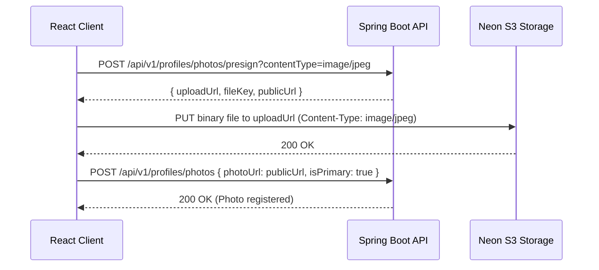

# Frontend Integration Guide & MVP API Specification

> **For Frontend Developers:** This document details all available REST APIs, WebSocket real-time protocols, S3 photo upload procedures, TypeScript types, and an actionable checklist for building the React MVP.

---

## 1. Quick Start & Connection Details

* **Backend Local Base URL:** `http://localhost:8080`
* **Interactive Swagger UI:** `http://localhost:8080/swagger-ui/index.html` (or `http://localhost:8080/swagger-ui.html`)
* **OpenAPI Specification (JSON):** `http://localhost:8080/v3/api-docs`
* **Health Check Endpoint:** `http://localhost:8080/health`
* **WebSocket Endpoint:** `http://localhost:8080/ws` (SockJS fallback enabled)
* **Auth Scheme:** Stateless JWT (`Authorization: Bearer <token>`)
* **Default Content-Type:** `application/json`

### Recommended Frontend Tech Stack
* **Framework:** React 18+ with TypeScript (Vite template recommended)
* **Styling:** Tailwind CSS + Lucide React (`lucide-react`)
* **Swiping Gesture Physics:** `framer-motion` (or `react-tinder-card`)
* **State Management:**
  * **Server Cache:** `@tanstack/react-query` (TanStack Query)
  * **Client Global Store:** `zustand` (Auth session, active match modal)
* **Real-time Client:** `@stomp/stompjs` + `sockjs-client`

---

## 2. Complete REST API Reference

### 2.1 Authentication & User Session

#### 1. Register User
Creates a new account and returns a JWT token.
* **Method & URL:** `POST /api/v1/auth/register`
* **Headers:** `Content-Type: application/json`
* **Request Body:**
  ```json
  {
    "email": "user@example.com",
    "password": "password123"
  }
  ```
* **Success Response (`200 OK`):**
  ```json
  {
    "token": "eyJhbGciOiJIUzUxMiJ9...",
    "tokenType": "Bearer",
    "userId": "b42d5299-3ca5-4614-863a-ab9a3cb59002",
    "email": "user@example.com",
    "profileCompleted": false
  }
  ```
* **Notes:** If `profileCompleted` is `false`, redirect the user to `/onboarding`.

---

#### 2. Login User
Authenticates existing credentials and returns a JWT token.
* **Method & URL:** `POST /api/v1/auth/login`
* **Headers:** `Content-Type: application/json`
* **Request Body:**
  ```json
  {
    "email": "user@example.com",
    "password": "password123"
  }
  ```
* **Success Response (`200 OK`):**
  ```json
  {
    "token": "eyJhbGciOiJIUzUxMiJ9...",
    "tokenType": "Bearer",
    "userId": "b42d5299-3ca5-4614-863a-ab9a3cb59002",
    "email": "user@example.com",
    "profileCompleted": true
  }
  ```

---

#### 3. Get Current User Info
* **Method & URL:** `GET /api/v1/auth/me`
* **Headers:** `Authorization: Bearer <token>`
* **Success Response (`200 OK`):**
  ```json
  {
    "userId": "b42d5299-3ca5-4614-863a-ab9a3cb59002",
    "email": "user@example.com",
    "status": "ACTIVE"
  }
  ```

---

### 2.2 Profile Management & S3 Photo Upload

#### 1. Get Own Profile
* **Method & URL:** `GET /api/v1/profiles/me`
* **Headers:** `Authorization: Bearer <token>`
* **Success Response (`200 OK`):**
  ```json
  {
    "userId": "b42d5299-3ca5-4614-863a-ab9a3cb59002",
    "email": "alex.dating@example.com",
    "firstName": "Alex",
    "birthDate": "1998-05-14",
    "age": 28,
    "gender": "MALE",
    "genderPreference": "EVERYONE",
    "bio": "Adventure seeker, love hiking and coffee chats.",
    "latitude": 37.7749,
    "longitude": -122.4194,
    "city": "San Francisco",
    "maxDistanceKm": 50,
    "minAgePref": 21,
    "maxAgePref": 32,
    "photos": [
      {
        "id": "61dbe8ed-f128-43a9-bea0-d43abdbae79a",
        "photoUrl": "https://br-tiny-dream-b45jaadl.storage.c-6.us-east-2.aws.neon.tech/photos/...",
        "displayOrder": 0,
        "isPrimary": true
      }
    ]
  }
  ```

---

#### 2. Create or Update Profile (Onboarding / Edit Profile)
* **Method & URL:** `PUT /api/v1/profiles/me`
* **Headers:** `Authorization: Bearer <token>`, `Content-Type: application/json`
* **Request Body:**
  ```json
  {
    "firstName": "Alex",
    "birthDate": "1998-05-14",
    "gender": "MALE",
    "genderPreference": "FEMALE",
    "bio": "Designer & coffee lover",
    "latitude": 37.7749,
    "longitude": -122.4194,
    "city": "San Francisco",
    "maxDistanceKm": 50,
    "minAgePref": 21,
    "maxAgePref": 35
  }
  ```
* **Success Response (`200 OK`):** Returns updated Profile object.

---

#### 3. 3-Step S3 Direct Photo Upload Procedure
Photos are uploaded directly to Neon's S3-compatible storage via pre-signed URLs to keep backend traffic lightweight.



1. **Step 1: Request Pre-signed URL**
   * `POST /api/v1/profiles/photos/presign?contentType=image/jpeg`
   * Response:
     ```json
     {
       "uploadUrl": "https://...neon.tech/photos/user-xxx/uuid.jpg?X-Amz-Algorithm=...",
       "fileKey": "user-xxx/uuid.jpg",
       "publicUrl": "https://...neon.tech/photos/user-xxx/uuid.jpg"
     }
     ```
2. **Step 2: Upload Binary Directly to S3**
   * Perform an HTTP `PUT` request directly to `uploadUrl` with the raw file as the body and matching `Content-Type: image/jpeg`.
3. **Step 3: Register Photo in Profile**
   * `POST /api/v1/profiles/photos`
   * Body:
     ```json
     {
       "photoUrl": "https://...neon.tech/photos/user-xxx/uuid.jpg",
       "isPrimary": true
     }
     ```

#### 4. Delete Photo
* **Method & URL:** `DELETE /api/v1/profiles/photos/{photoId}`
* **Headers:** `Authorization: Bearer <token>`
* **Success Response (`200 OK`):** `{"message": "Photo deleted successfully"}`

---

### 2.3 Discovery Feed & Swiping Engine

#### 1. Fetch Discovery Card Deck
Fetches candidate profiles matching age and gender filters, calculated distance in km, excluding users already swiped on or blocked.
* **Method & URL:** `GET /api/v1/discovery/feed?limit=20`
* **Headers:** `Authorization: Bearer <token>`
* **Success Response (`200 OK`):**
  ```json
  [
    {
      "userId": "894e3482-4c1f-4824-8438-2209e6b60bed",
      "firstName": "Sophia",
      "age": 27,
      "gender": "FEMALE",
      "bio": "Designer, art enthusiast, foodie.",
      "city": "San Francisco",
      "distanceKm": 1.0,
      "photos": [
        {
          "id": "a86d54de-0ea1-49c0-b71e-a447e9c819a1",
          "photoUrl": "https://images.unsplash.com/...",
          "displayOrder": 0,
          "isPrimary": true
        }
      ]
    }
  ]
  ```

---

#### 2. Submit a Swipe (Like or Pass)
* **Method & URL:** `POST /api/v1/swipes`
* **Headers:** `Authorization: Bearer <token>`, `Content-Type: application/json`
* **Request Body:**
  ```json
  {
    "targetUserId": "894e3482-4c1f-4824-8438-2209e6b60bed",
    "swipeType": "LIKE"
  }
  ```
  *(Allowed `swipeType` values: `"LIKE"` or `"PASS"`)*

* **Response If NO Mutual Match (`200 OK`):**
  ```json
  {
    "match": false,
    "matchId": null,
    "matchedProfile": null
  }
  ```

* **Response When IT'S A MATCH! (`200 OK`):**
  ```json
  {
    "match": true,
    "matchId": "242e84b7-c4e9-47f5-ae4f-e5e8970bbc8d",
    "matchedProfile": {
      "userId": "894e3482-4c1f-4824-8438-2209e6b60bed",
      "firstName": "Sophia",
      "age": 27,
      "gender": "FEMALE",
      "bio": "Designer, art enthusiast, foodie.",
      "city": "San Francisco",
      "distanceKm": null,
      "photos": [ ... ]
    }
  }
  ```
  *When `match === true`, immediately trigger the `<MatchCelebrationModal />`!*

---

### 2.4 Matches & Real-Time Chat

#### 1. Get Active Matches List
* **Method & URL:** `GET /api/v1/matches`
* **Headers:** `Authorization: Bearer <token>`
* **Success Response (`200 OK`):**
  ```json
  [
    {
      "matchId": "242e84b7-c4e9-47f5-ae4f-e5e8970bbc8d",
      "targetUserId": "894e3482-4c1f-4824-8438-2209e6b60bed",
      "targetFirstName": "Sophia",
      "targetPhotoUrl": "https://images.unsplash.com/...",
      "lastMessage": "Hey Sophia! Loved your design portfolio...",
      "lastMessageTime": "2026-10-29T10:18:10.114Z",
      "unreadCount": 0,
      "matchedAt": "2026-10-29T10:16:51.725Z"
    }
  ]
  ```

---

#### 2. Unmatch a User
* **Method & URL:** `DELETE /api/v1/matches/{matchId}`
* **Headers:** `Authorization: Bearer <token>`
* **Success Response (`200 OK`):** `{"message": "Unmatched successfully"}`

---

#### 3. Fetch Paginated Chat History
* **Method & URL:** `GET /api/v1/matches/{matchId}/messages?page=0&size=50`
* **Headers:** `Authorization: Bearer <token>`
* **Success Response (`200 OK`):**
  ```json
  {
    "content": [
      {
        "id": "ec0c4e45-907a-4987-ac1d-25747ce55964",
        "matchId": "242e84b7-c4e9-47f5-ae4f-e5e8970bbc8d",
        "senderId": "b42d5299-3ca5-4614-863a-ab9a3cb59002",
        "content": "Hey Sophia! How are you?",
        "sentAt": "2026-10-29T10:18:10.114664Z",
        "read": false
      }
    ],
    "totalPages": 1,
    "totalElements": 1,
    "size": 50,
    "number": 0
  }
  ```

---

#### 4. Send Message via REST (Fallback)
* **Method & URL:** `POST /api/v1/matches/{matchId}/messages`
* **Headers:** `Authorization: Bearer <token>`, `Content-Type: application/json`
* **Request Body:**
  ```json
  {
    "content": "Are you free this weekend for coffee?"
  }
  ```

---

## 3. Real-Time WebSockets (STOMP Protocol)

### Connecting to the WebSocket Broker
Install dependencies:
```bash
npm install @stomp/stompjs sockjs-client
```

### Setup Code Snippet
```typescript
import { Client } from '@stomp/stompjs';
import SockJS from 'sockjs-client';

const token = localStorage.getItem('token');

const stompClient = new Client({
  webSocketFactory: () => new SockJS('http://localhost:8080/ws'),
  connectHeaders: {
    Authorization: `Bearer ${token}`
  },
  reconnectDelay: 5000,
  heartbeatIncoming: 4000,
  heartbeatOutgoing: 4000,
});

stompClient.onConnect = () => {
  console.log('Connected to WebSocket!');

  // 1. Subscribe to Live Match Chat
  const matchId = '242e84b7-c4e9-47f5-ae4f-e5e8970bbc8d';
  stompClient.subscribe(`/topic/match.${matchId}`, (frame) => {
    const newMessage = JSON.parse(frame.body);
    console.log('New incoming message:', newMessage);
  });

  // 2. Subscribe to Instant Match Notifications
  stompClient.subscribe(`/user/queue/notifications`, (frame) => {
    const notification = JSON.parse(frame.body);
    if (notification.type === 'MATCH') {
      // Trigger "It's a Match!" celebration modal
      console.log('Match popup triggered:', notification);
    }
  });
};

stompClient.activate();

// Send message via WebSocket
export const sendChatMessage = (matchId: string, content: string) => {
  stompClient.publish({
    destination: '/app/chat.sendMessage',
    body: JSON.stringify({ matchId, content })
  });
};
```

---

## 4. Frontend Developer Action Checklist

Follow this implementation checklist:

- [ ] **Step 1: Scaffolding**
  - Run `npm create vite@latest frontend -- --template react-ts`
  - Install dependencies: `tailwindcss`, `lucide-react`, `framer-motion`, `@tanstack/react-query`, `zustand`, `axios`, `react-router-dom`, `@stomp/stompjs`, `sockjs-client`.
  - Configure Tailwind in `tailwind.config.js`.

- [ ] **Step 2: Auth Layer & Protected Routing**
  - Create `useAuthStore` in Zustand to hold `{ token, user, isAuthenticated }`.
  - Create Axios interceptor attaching `Authorization: Bearer ${token}`.
  - Implement `/login` and `/register` views.
  - Check `profileCompleted` on login: if `false`, route to `/onboarding`.

- [ ] **Step 3: Profile Onboarding & S3 Photo Upload**
  - Profile form: Name, birth date (datepicker), gender select, gender preference select, bio textarea, location coords/city.
  - 6-slot photo uploader component implementing the 3-step S3 pre-signed upload flow.

- [ ] **Step 4: Discovery Swiping Deck (`/app/explore`)**
  - Use `framer-motion` to drag cards horizontally:
    - Drag right $> 120\text{px}$ $\to$ Trigger `POST /api/v1/swipes` with `LIKE`.
    - Drag left $< -120\text{px}$ $\to$ Trigger `POST /api/v1/swipes` with `PASS`.
  - When API returns `match: true`, open `<MatchCelebrationModal />` with confetti effect and options: "Chat Now" or "Keep Swiping".
  - Empty state when deck is exhausted: "No more profiles nearby."

- [ ] **Step 5: Matches & Chat UI (`/app/matches` & `/app/chat/:matchId`)**
  - Horizontal list of new matches (avatars with badges).
  - Vertical list of active chat threads showing last message preview.
  - Chat window: message bubbles (outgoing right/pink, incoming left/gray), bottom input bar with send button.
  - STOMP subscription appending live messages to chat thread without requiring full page refetch.
