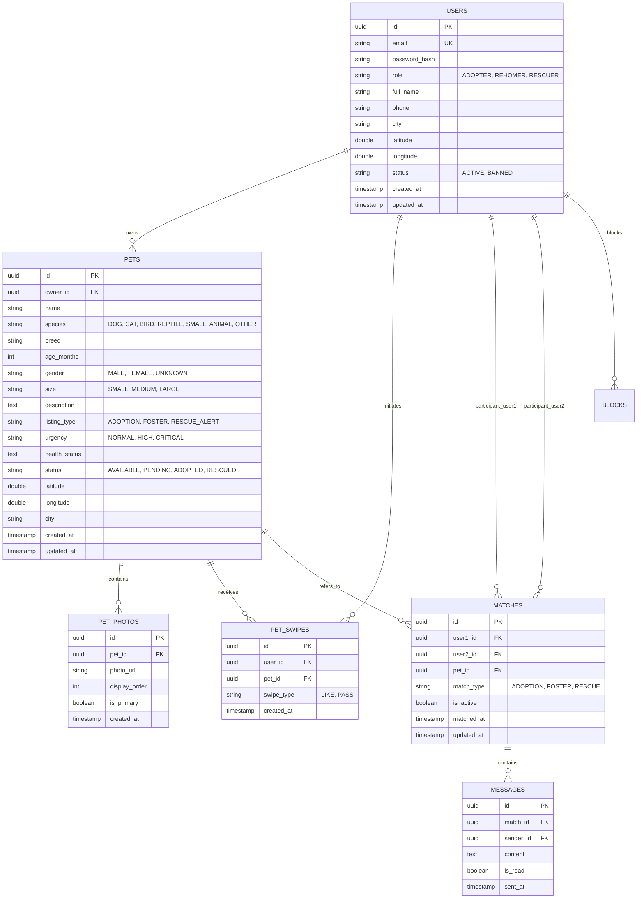

# MeaowMatch — Master Product Requirement Document (PRD) & Technical Architecture Plan

---

## 1. Executive Summary & Product Vision

### 1.1 Product Vision
**MeaowMatch** is a modern, ethical, and community-driven Pet Adoption & Emergency Animal Rescue platform. It bridges the gap between animals in need and the humans ready to help them through intuitive card-based discovery, real-time messaging, and location-based rescue alerts.

MeaowMatch supports **all types of animals**, including:
* **Dogs & Puppies**
* **Cats & Kittens**
* **Birds** (Parrots, Pigeons, Rescue Wild Birds)
* **Reptiles** (Turtles, Geckos, Snakes)
* **Small Animals** (Rabbits, Hamsters, Guinea Pigs)
* **Other / Farm Animals**

---

### 1.2 The Three User Roles

MeaowMatch empowers three distinct user roles within one unified platform:

1. 🐾 **The Adopter (`ADOPTER`)**:
   - Browses available pets nearby using an intuitive card deck.
   - Filters by species (Dogs, Cats, Birds, Reptiles, Small Animals) and distance (km).
   - Swipes **LIKE** to submit an adoption inquiry or **PASS**.
   - Upon matching, connects instantly with the pet's guardian in real-time chat.

2. 🏡 **The Re-homer / Shelter (`REHOMER`)**:
   - Pet owners facing relocation or licensed animal shelters with rescues.
   - Uploads high-resolution pet photos directly to Neon S3 Object Storage via pre-signed URLs.
   - Manages pet listings (age, breed, medical history, vaccination status, temperament).
   - Receives instant adoption inquiries and reviews potential adopters.

3. 🚨 **The Rescue Reporter (`RESCUER`)**:
   - Kind citizens and animal spotters who encounter injured, sick, or stranded animals on the street.
   - Can submit an emergency **Rescue Alert** with a single click: photo, injury details, GPS coordinates, and urgency (`CRITICAL` / `HIGH`).
   - Local volunteers and veterinary rescue teams discover alerts within 25–50 km and claim them to coordinate rescue operations in real time.

---

### 1.3 Feature Matrix

| Feature Category | In MVP Scope | Post-MVP Roadmap |
| :--- | :--- | :--- |
| **Authentication** | Email/Password with JWT, BCrypt, Role Selection (`ADOPTER`, `REHOMER`, `RESCUER`) | Phone OTP (Twilio), Google OAuth |
| **Pet Profiles** | Name, Species, Breed, Age, Gender, Size, Medical/Vaccination Bio, 1–6 S3 Photos | Microchip registry lookup, DNA breed testing |
| **Adoption Feed** | Deck of nearby pets filtered by species, listing type, distance (Haversine) | Personality compatibility scoring |
| **Emergency Alerts** | Dedicated emergency feed for injured animals prioritized by `CRITICAL` urgency | Automated dispatch to registered vet ambulances |
| **Inquiries & Matching** | Swipe-based adoption inquiries, instant match creation, owner alerts | Adoption contract signing, background check checks |
| **Real-Time Chat** | 1-on-1 STOMP WebSockets (`/ws`), unread counts, typing states | Photo/video sharing in chat, voice calls |
| **Safety & Moderation**| Block user, report abusive listings, close conversations | Verified shelter badges, volunteer certifications |

---

## 2. System Architecture Overview

```mermaid
flowchart TD
    subgraph Client ["Frontend (React SPA)"]
        UI["React 18 + Vite + Tailwind"]
        State["React State + Axios API"]
        WSClient["SockJS + STOMP Client"]
    end

    subgraph AWS ["AWS Cloud Infrastructure (EC2)"]
        subgraph DockerHost ["Docker Engine / Docker Compose"]
            Nginx["Nginx Reverse Proxy / Static Host (Port 3000)"]
            BackContainer["MeaowMatch Spring Boot 3 REST & STOMP (Port 8080)"]
        end
        S3["Neon S3 Object Storage (Pet Photos)"]
    end

    subgraph Database ["Neon DB (Serverless PostgreSQL)"]
        NeonPool["Neon Connection Pool (PgBouncer - Port 6543)"]
        PostgresDB[("PostgreSQL 16 + Haversine Geo Indices")]
    end

    UI --> Nginx
    WSClient --> BackContainer
    Nginx -->|/ (Static Assets)| UI
    UI -->|REST API Requests| BackContainer
    BackContainer -->|"JDBC TLS/SSL"| NeonPool
    NeonPool --> PostgresDB
    BackContainer -->|"Pre-signed PUT URLs"| S3
    UI -->|"Direct Binary Upload"| S3
```

---

## 3. Database Schema Specification



---

## 4. REST API & WebSocket Protocol

### 4.1 Authentication Endpoints (`/api/v1/auth`)
* `POST /api/v1/auth/register`: Register user with role (`ADOPTER`, `REHOMER`, `RESCUER`).
* `POST /api/v1/auth/login`: Authenticate and obtain JWT.
* `GET /api/v1/auth/me`: Get current user profile.
* `PUT /api/v1/auth/me`: Update name, phone, city, or GPS coordinates.

### 4.2 Pet Listings Endpoints (`/api/v1/pets`)
* `POST /api/v1/pets`: Create pet listing (Adoption, Foster, or Rescue).
* `GET /api/v1/pets/{id}`: Get pet details.
* `PUT /api/v1/pets/{id}`: Update pet details or status.
* `DELETE /api/v1/pets/{id}`: Delete pet listing.
* `GET /api/v1/pets/my-pets`: List pets owned by logged-in user.
* `POST /api/v1/pets/photos/presign`: Request S3 pre-signed upload URL for direct photo upload.

### 4.3 Discovery Endpoints (`/api/v1/discovery`)
* `GET /api/v1/discovery/pets`: Query adoptable pets nearby:
  - Query parameters: `species`, `listingType`, `latitude`, `longitude`, `maxDistanceKm`, `limit`.
  - Calculates distance using PostgreSQL Haversine spherical distance.

### 4.4 Emergency Rescue Alerts Endpoints (`/api/v1/rescue-alerts`)
* `POST /api/v1/rescue-alerts`: Report injured/stray animal with GPS coordinates and urgency (`CRITICAL`).
* `GET /api/v1/rescue-alerts/nearby`: Discover open rescue alerts nearby (sorted with `CRITICAL` urgency first).
* `POST /api/v1/rescue-alerts/{id}/respond`: Volunteer or shelter claims the rescue alert, instantly creating an active match & opening live coordination chat.

### 4.5 Adoption Swipes Endpoints (`/api/v1/swipes`)
* `POST /api/v1/swipes`: Submit swipe (`LIKE` or `PASS`) on a pet. If `LIKE`, an adoption inquiry match is created and the owner is notified in real time.

### 4.6 Conversations & Real-Time Chat (`/api/v1/matches`)
* `GET /api/v1/matches`: List active adoption and rescue conversations with latest message & unread count.
* `GET /api/v1/matches/{matchId}/messages`: Paginated conversation message history.
* `POST /api/v1/matches/{matchId}/messages`: Send message via REST.
* `POST /api/v1/matches/{matchId}/read`: Mark unread messages as read.
* `DELETE /api/v1/matches/{matchId}`: Close conversation.

### 4.7 Real-Time STOMP WebSockets (`/ws`)
* **Handshake Endpoint**: `http://<EC2_IP>:8080/ws` (SockJS enabled).
* **Authentication**: Pass header `Authorization: Bearer <jwt_token>` in STOMP `CONNECT` frame.
* **Subscribe to Conversation**: `/topic/match.{matchId}`.
* **Send Message**: Publish to `/app/chat.sendMessage` with payload `{"matchId": "...", "content": "..."}`.
* **User Notifications**: Subscribe to `/user/queue/notifications` for instant match and rescue response alerts.

---

## 5. Deployment & Infrastructure

The MeaowMatch backend is containerized with Docker and ready for **AWS EC2 Free Tier (`t2.micro`)**:
* **Backend Port**: `8080` (Spring Boot 3 + Java 21)
* **Frontend Port**: `3000` (React + Vite + Nginx)
* **Database**: Neon Serverless PostgreSQL with PgBouncer connection pooling.
* **Object Storage**: Neon S3-compatible bucket for pet photos.
* **CORS Script**: Run `./scripts/update-cors.sh <FRONTEND_IP>` on the Backend EC2 instance.
* **Endpoint Script**: Run `./scripts/update-backend-url.sh <BACKEND_IP>` on the Frontend EC2 instance.
